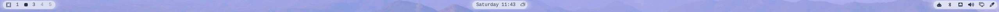
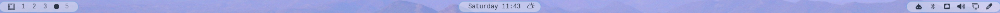
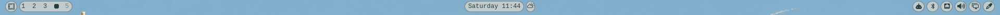
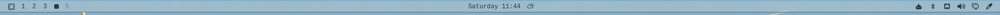
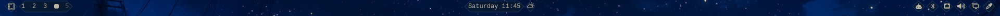
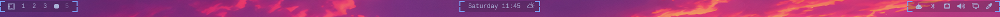

# Isles

**Version 1.1.0.** Theme-aware islands behind the stock [Omarchy](https://omarchy.org/) bar. They resize as widgets appear and disappear, with six built-in presets and controls for saving your own looks.

**Compatibility:** tested on **Omarchy 4.5.0-3 (Quattro RS)**. Isles reads the bar’s internal QML layout to measure widgets; future Omarchy changes may require an Isles update. See [how it works](#how-it-works) below.

## Install

```bash
omarchy plugin add https://github.com/Inxeo/omarchy-isles.git --enable
omarchy bar move io.github.inxeo.isles --section right
omarchy bar transparent true
```

New installs start with **Glowy**. Existing appearance settings are preserved.

Omarchy 4.5 lays widgets out in five strip sections (`left`, `centerBegin`, `center`, `centerEnd`, `right`). Isles paints one cluster island per occupied section. Widgets in the **tray** drawer are left undecorated. A widget dragged off the bar is skipped, so it does not leave a ghost island. Put a widget beside the clock in `centerBegin` or `centerEnd` rather than in `center`, so the clock stays centred.

## Use the menu

1. Click the **paintbrush** on the bar (tooltip: **Island appearance**) to open the menu.
2. **Show islands** turns painting on or off without changing the saved look.
3. Choose a **preset**. **Undo** appears after applying one, and **Reset to Glowy** restores the default look.
4. Open **Customize** to change Look, Border Style, and the sliders. The bar updates while you drag; the value is saved when you release. Hide Customize if you only use presets.
5. To keep a look, enter a name and click **Save** or press Enter. Reusing a personal preset’s name asks you to confirm **Replace**. **Delete** also asks for confirmation and keeps the current look on the bar.

A **Custom** note appears when the current look does not match a preset. Names support up to 40 characters; built-in names are reserved. Save failures use a distinct colour and offer **Retry**. Scroll the menu on smaller displays.

**Auto contrast** is optional and off by default. It sits below Customize and is independent of presets: switching looks keeps the toggle as it is. It chooses a light or dark island background against Omarchy’s current bar text colour, using at least 92% opacity for light backgrounds and 85% for dark backgrounds, or more when needed for contrast. The opacity slider still stores your value; when Auto contrast raises fill, the label shows **saved** and **shown** percentages. Turn it off to restore the normal theme background. It targets the main bar text, not individually coloured icons or text outside the filled island area.

| Control | Effect |
|---|---|
| Show islands | Paint or hide the islands |
| Preset | Apply a built-in or personal look; Custom means the bar does not match a saved preset |
| Look | Cluster: one island per strip section; Pills: one island per widget; Rail: a full-length strip along the bar edge; Power: chevron segments; Brackets: corner marks; Glow: softly glowing clusters |
| Border Style | All, Pointed, Top, Bottom, Top+bot (top and bottom), or Sides; hidden for Power and Brackets, which draw their own outline |
| Padding | Space around the widgets |
| Corner Radius | 0 square, 100 pill; hidden for Power, Brackets, and Pointed |
| Background Opacity | Saved fill transparency. Auto contrast may show a higher **shown** fill |
| Border Width | Outline thickness; **0** hides it |
| Border Opacity | Outline transparency; hidden while width is 0 |
| Auto contrast | Light or dark fill against bar text; may raise displayed opacity |

Personal presets save appearance only. Show islands and Auto contrast stay as they are. Presets are stored in Isles’ settings in `~/.config/omarchy/shell.json` and survive shell restarts and plugin updates.

## Presets and examples

Colours follow your active theme. These screenshots show the stock bar with Isles across different themes and wallpapers.

### Glowy — default

Softly glowing rounded clusters, with no outline.



### Halo

Rounded clusters with a fine outline.



### Pebbles

Individual rounded islands around each widget.



### Underline

A translucent rail with a bottom accent.



### Diamonds

Individual pointed islands that show off angular outlines.



### Blueprint

Lightly filled clusters with corner brackets.



## How it works

Isles runs as a single bar-widget, with a menu loaded by that widget. It reads neighbouring bar slots’ geometry and visibility, then draws beneath the widgets on the bar’s current edge. On Omarchy 4.5 the bar window is a full-screen transparent surface; Isles sizes its chrome to that edge so Rail and the other looks follow top, bottom, left, and right bars. It skips tray-drawer slots and any slot that is the active drag source or pending removal, so a widget pulled off the bar does not leave a ghost island. It does not replace the bar or change other widgets’ settings, transparency, or icon colours.

Slot discovery depends on Omarchy’s internal scene structure, rather than a stable public geometry API. Isles retries discovery and logs a warning if compatible slots cannot be found. If the islands disappear after an Omarchy update, this adapter is the first compatibility check.

Settings are written through Omarchy’s scoped API for Isles’ own entry. Isles reads `shell.json` to verify saves and attempts recovery if verification fails, without overwriting conflicting newer edits. Unsupported saved preset records are retained for future compatibility.

The installed plugin runs inside the existing shell process. It makes no network requests, launches no external commands, and requires no elevated privileges. Like other Omarchy QML plugins, it runs with the user’s permissions and is not sandboxed.

Top, bottom, left, and right bars are supported. On transparent bars, Omarchy controls icon contrast using the wallpaper; some theme and wallpaper combinations can make icons difficult to see, particularly on vertical bars. Isles does not override that colour choice; Auto contrast adapts the island background instead.

## Remove

```bash
omarchy plugin remove io.github.inxeo.isles --yes
```

The stock widgets remain in place. Any bar transparency you set during setup remains your own setting.

## Development

```bash
omarchy plugin validate .
python3 tests/run-lint.py
node tests/presets.cjs
python3 tests/run-integration.py
```

The lint runner uses Qt 6 and the installed Omarchy imports, and fails on diagnostics outside an explicitly reviewed baseline. A pass is not warning-free lint; see [the lint notes](tests/LINT.md).

The integration suite requires an Omarchy Wayland session. It uses temporary settings, a mock host API, and isolated Quickshell test processes to check the actual QML components, save recovery, preset deletion, undo, live slider preview, rendering, and restart persistence. It does not alter your bar settings.

CPU/GPU savings have not been benchmarked. See [CHANGELOG.md](CHANGELOG.md) for the v1.1 changes and validation history.

## Credits and license

Inspired by [Rice Bar](https://github.com/jcarcinogen/omarchy-rice-bar) and its approach to decorating the stock bar. Omarchy 4.0.3 introduced [“Restrict third-party shell plugin capabilities”](https://github.com/omacom/omarchy/commit/1702cf0bee025aa32eddac391c4f9ac32244cfeb), replacing the live bar object supplied to third-party widgets with a scoped `PluginBarApi`. This removed the direct access to bar internals that Rice Bar’s original approach relied on. Isles brings a similar effect to Omarchy 4.5 by measuring neighbouring QML slots and drawing beneath the widgets, as described above.

- **Inxeo** — design, testing, and direction
- **Grok** ([Grok Build](https://x.ai/)) — implementation
- **OpenAI Codex** — AI-assisted development, review, optimisation, tests, and documentation

[MIT license](LICENSE).
